<!-- ==========================================================================
     PERFIL GITHUB - Pedro Luiz R. Vaz de Melo
     Estetica: "Geospatial dark editorial", versao compacta.
     Manutencao:
       - miniaturas dos projetos em ./assets/readme/ (800x500, 16:10, JPG).
       - o camo do GitHub cacheia por URL: ao trocar uma miniatura, use nome NOVO.
       - grade de projetos em tabela de 2 colunas; mantenha numero PAR de cards
         em cada grupo para nao sobrar celula vazia.
       - toda imagem precisa de alt significativo em PT-BR.
       - ./assets/stats/ e gerado pelo workflow atualizar-estatisticas.yml
         (GitHub Stats Extended, todo dia): nao edite esses SVGs a mao; ajuste
         as opcoes dos cards no workflow. O bot faz commit diario: rode
         "git pull" antes de editar o README.
       - numeros apenas de fatos reais; detalhes completos ficam no portfolio.
       - dados publicos: nome, e-mail, GitHub, LinkedIn e cidade (sem telefone/CREA).
     ========================================================================== -->

  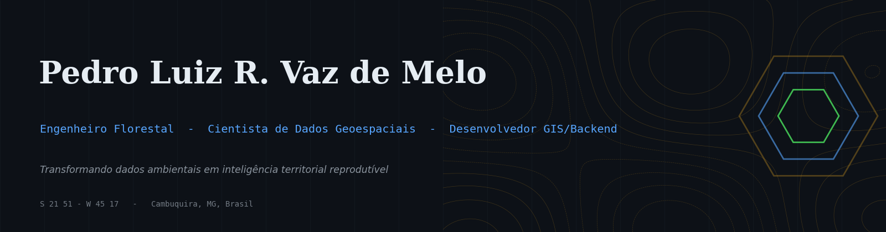

  
<b>Uno inteligência territorial e ciência de dados a back-ends de alta performance.</b> 
  Pipelines geoespaciais que levam de dias para minutos, servidos como WebMaps, dashboards e APIs.

  
  
  

  
Cambuquira, MG, Brasil · trabalho remoto

---

## Sobre

**Engenheiro Florestal** (UFSJ, 2025) e **Cientista de Dados Geoespaciais**, com base sólida em back-end. Automatizo pipelines de dados ambientais com **Python** e **Google Earth Engine**, sirvo os resultados por APIs em **FastAPI** ou **Node.js/TypeScript** e entrego tudo como WebMaps e dashboards que substituem PDFs estáticos.

- **Hoje:** cientista de dados na **EnvironBIT** (projeto CNPq) e consultor de geoprocessamento na **Vimef Engenharia** (linhas de transmissão e compensação ambiental).
- **Formação:** pós-graduação em Ciência de Dados na Data Science Academy.
- **Foco:** ETL geoespacial, sensoriamento remoto, machine learning florestal, WebGIS e APIs.

---

## Stack

  

<table align="center">
  <tr>
    <td><b>Geoespacial</b></td>
    <td>
      
      
      
      
      
      
      
      
      
    </td>
  </tr>
  <tr>
    <td><b>Back-end e dados</b></td>
    <td>
      
      
      
      
      
      
      
    </td>
  </tr>
  <tr>
    <td><b>Ciência de dados e IA</b></td>
    <td>
      
      
      
      
      
      
      
    </td>
  </tr>
  <tr>
    <td><b>WebGIS e visualização</b></td>
    <td>
      
      
      
      
      
    </td>
  </tr>
  <tr>
    <td><b>Operação</b></td>
    <td>
      
      
      
      
      
    </td>
  </tr>
</table>

---

## Projetos em destaque

Reprodutíveis do dado bruto ao produto final. Galeria, vídeos e detalhes de cada um no **[portfólio](https://pedroluizskt.github.io/)**.

### Geoespacial e WebGIS

<table>
  <tr>
    <td width="50%" valign="top">
      <a href="https://pedroluizskt.github.io/florestas-publicas-brasil/">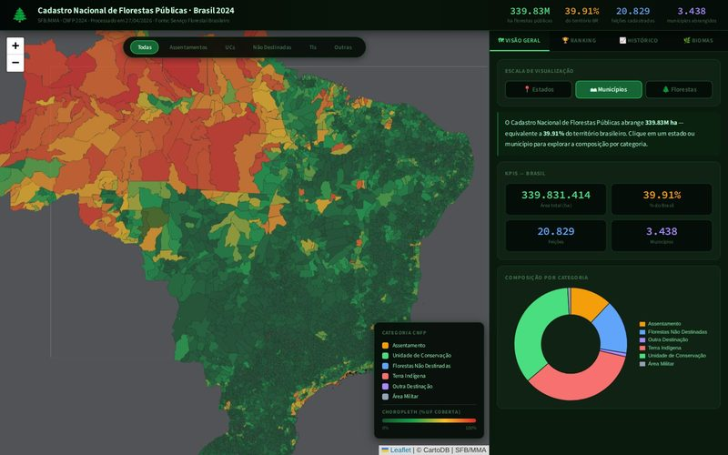</a>
       <b><a href="https://github.com/PedroLuizskt/florestas-publicas-brasil">Florestas Públicas do Brasil</a></b>
       CNFP 2024 em WebMap: 339,8 milhões de ha, 39,91% do território e 20.829 feições.
       <a href="https://github.com/PedroLuizskt/florestas-publicas-brasil">Código</a> · <a href="https://pedroluizskt.github.io/florestas-publicas-brasil/">WebMap ao vivo</a>
    </td>
    <td width="50%" valign="top">
      <a href="https://pedroluizskt.github.io/enso-centro-oeste/">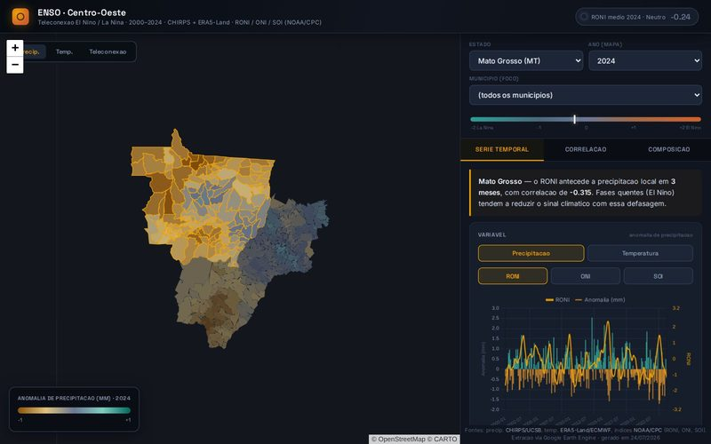</a>
       <b><a href="https://github.com/PedroLuizskt/enso-centro-oeste">ENSO no Centro-Oeste</a></b>
       Teleconexão El Niño × clima em 468 municípios, com dashboard que funciona offline.
       <a href="https://github.com/PedroLuizskt/enso-centro-oeste">Código</a> · <a href="https://pedroluizskt.github.io/enso-centro-oeste/">Dashboard ao vivo</a>
    </td>
  </tr>
  <tr>
    <td width="50%" valign="top">
      <a href="https://pedroluizskt.github.io/gee-precipitation-webmap-mg/webmap_precipitacao_fevereiro.html">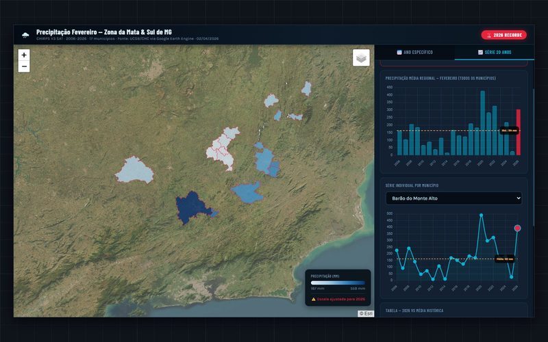</a>
       <b><a href="https://github.com/PedroLuizskt/gee-precipitation-webmap-mg">Chuva extrema na Zona da Mata</a></b>
       20 anos de CHIRPS no Earth Engine: Juiz de Fora com 558 mm (+183%) em fev/2026.
       <a href="https://github.com/PedroLuizskt/gee-precipitation-webmap-mg">Código</a> · <a href="https://pedroluizskt.github.io/gee-precipitation-webmap-mg/webmap_precipitacao_fevereiro.html">WebMap ao vivo</a>
    </td>
    <td width="50%" valign="top">
      <a href="https://pedroluizskt.github.io/open-buildings-explorer-br/">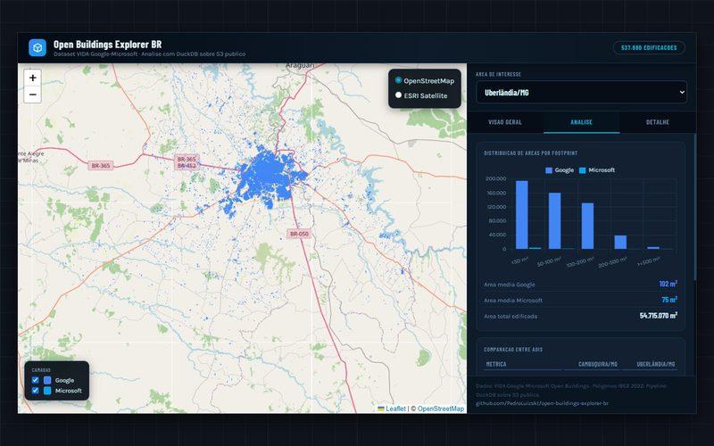</a>
       <b><a href="https://github.com/PedroLuizskt/open-buildings-explorer-br">Open Buildings Explorer BR</a></b>
       DuckDB direto do S3: 141 milhões de edificações no Brasil e webmap Google × Microsoft.
       <a href="https://github.com/PedroLuizskt/open-buildings-explorer-br">Código</a> · <a href="https://pedroluizskt.github.io/open-buildings-explorer-br/">WebMap ao vivo</a>
    </td>
  </tr>
  <tr>
    <td width="50%" valign="top">
      <a href="https://github.com/PedroLuizskt/brazil-hydro-dynamics">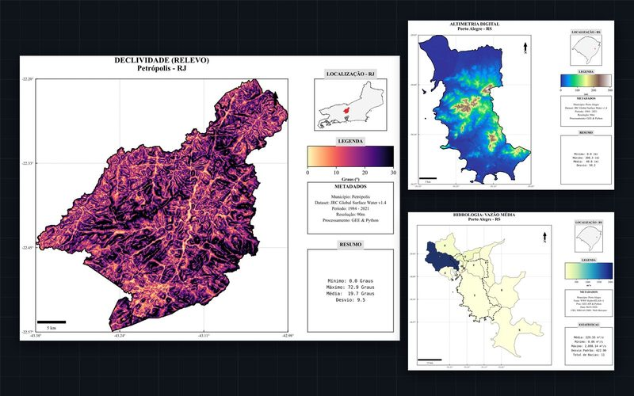</a>
       <b><a href="https://github.com/PedroLuizskt/brazil-hydro-dynamics">Brazil Hydro Dynamics</a></b>
       Microbacias, água superficial (1984–2021) e risco de inundação (HAND) no Earth Engine.
       <a href="https://github.com/PedroLuizskt/brazil-hydro-dynamics">Código</a>
    </td>
    <td width="50%" valign="top">
      <a href="https://pedroluizskt.github.io/Agrodados-imersao-dev/">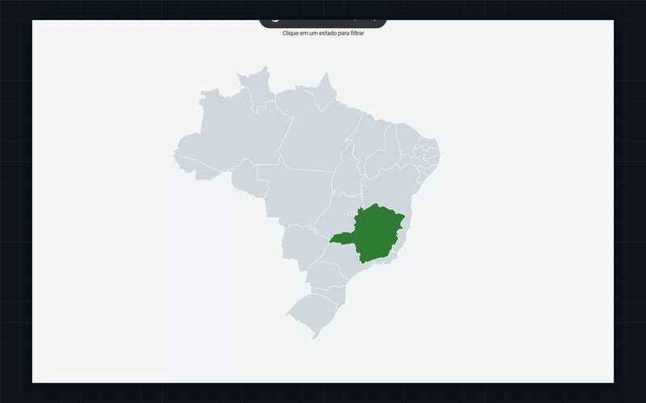</a>
       <b><a href="https://github.com/PedroLuizskt/Agrodados-imersao-dev">AgroDados</a></b>
       80 bases oficiais fundiárias e ambientais num mapa clicável das 27 UFs.
       <a href="https://github.com/PedroLuizskt/Agrodados-imersao-dev">Código</a> · <a href="https://pedroluizskt.github.io/Agrodados-imersao-dev/">Demo ao vivo</a>
    </td>
  </tr>
</table>

### Ciência de dados, IA e automação

<table>
  <tr>
    <td width="50%" valign="top">
      <a href="https://github.com/PedroLuizskt/forest-py-estudos">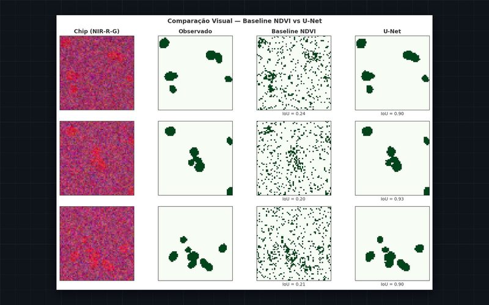</a>
       <b><a href="https://github.com/PedroLuizskt/forest-py-estudos">Forest-Py</a></b>
       ML e deep learning na engenharia florestal: 12 sessões, 223 testes e U-Net para copas.
       <a href="https://github.com/PedroLuizskt/forest-py-estudos">Código</a>
    </td>
    <td width="50%" valign="top">
      <a href="https://github.com/PedroLuizskt/datascience-projects/tree/main/projeto_01_espaco_vetorial_recomendador_municipios_agro">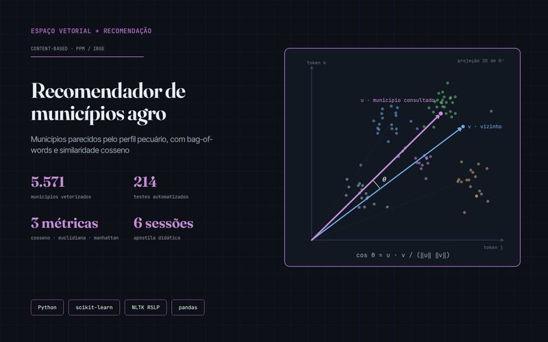</a>
       <b><a href="https://github.com/PedroLuizskt/datascience-projects/tree/main/projeto_01_espaco_vetorial_recomendador_municipios_agro">Recomendador de municípios agro</a></b>
       Perfil pecuário do IBGE em vetores: similaridade cosseno entre 5.571 municípios.
       <a href="https://github.com/PedroLuizskt/datascience-projects/tree/main/projeto_01_espaco_vetorial_recomendador_municipios_agro">Código</a>
    </td>
  </tr>
  <tr>
    <td width="50%" valign="top">
      <a href="https://github.com/PedroLuizskt/GeoPython-Assistant-v2">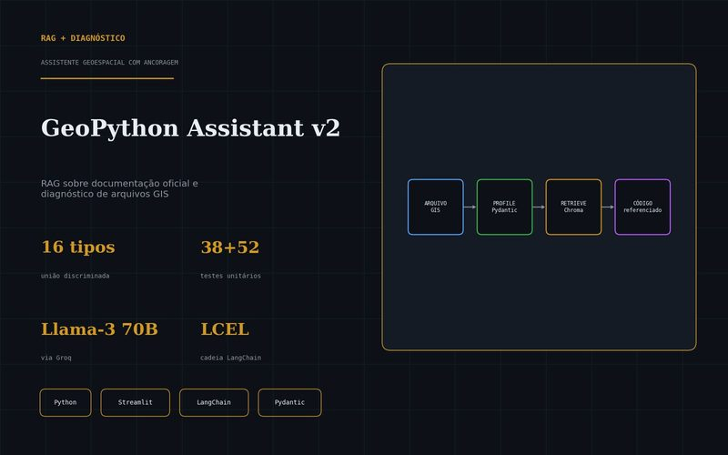</a>
       <b><a href="https://github.com/PedroLuizskt/GeoPython-Assistant-v2">GeoPython Assistant</a></b>
       Assistente de código geoespacial com LLM; a v2 usa RAG sobre a documentação oficial.
       <a href="https://github.com/PedroLuizskt/GeoPython-Assistant-v2">Código da v2</a> · <a href="https://geopython-assistant-skt.streamlit.app/">Demo da v1</a>
    </td>
    <td width="50%" valign="top">
      <a href="https://github.com/PedroLuizskt/Geospatial-Automation-Suite">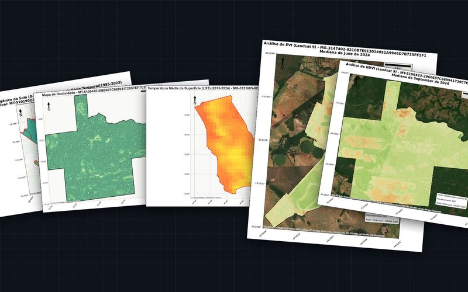</a>
       <b><a href="https://github.com/PedroLuizskt/Geospatial-Automation-Suite">Geospatial Automation Suite</a></b>
       Dossiês técnicos em PDF (CAR, solos, clima, uso do solo) em minutos, não em dias.
       <a href="https://github.com/PedroLuizskt/Geospatial-Automation-Suite">Código</a>
    </td>
  </tr>
</table>

### Back-end e observabilidade

<table>
  <tr>
    <td width="50%" valign="top">
      <a href="https://github.com/PedroLuizskt/fastapi-task-manager">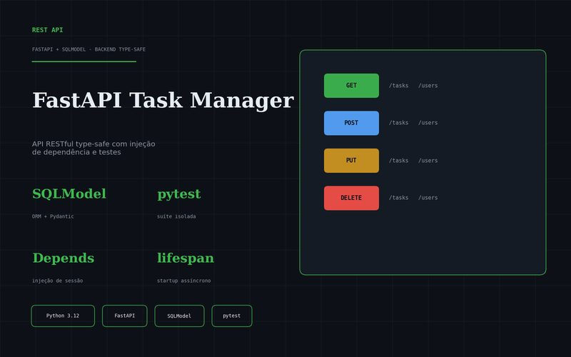</a>
       <b><a href="https://github.com/PedroLuizskt/fastapi-task-manager">FastAPI Task Manager</a></b>
       API RESTful type-safe com FastAPI e SQLModel, injeção de dependência e pytest.
       <a href="https://github.com/PedroLuizskt/fastapi-task-manager">Código</a>
    </td>
    <td width="50%" valign="top">
      <a href="https://github.com/PedroLuizskt/estudos-observabilidade">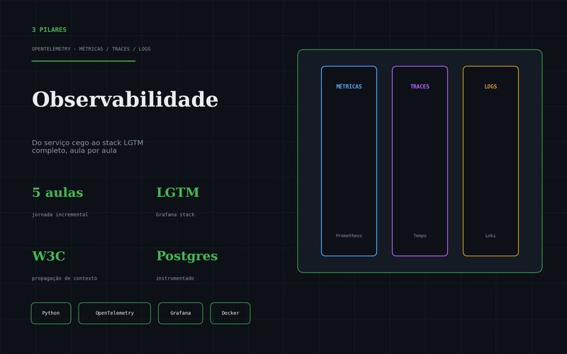</a>
       <b><a href="https://github.com/PedroLuizskt/estudos-observabilidade">Estudos de Observabilidade</a></b>
       Cinco aulas de OpenTelemetry: métricas, traces e logs no stack Grafana LGTM.
       <a href="https://github.com/PedroLuizskt/estudos-observabilidade">Código</a>
    </td>
  </tr>
</table>

<b>Mais projetos</b>

 

- **[Paraná: silvicultura e clima](https://pedroschuldiner1.users.earthengine.app/view/paran-cobertura-do-solo-deteco-florestal-e-estoque-de-c)** · Earth Engine App com uso do solo MapBiomas, florestas densas (Sentinel-2) e carbono (ESA CCI).
- **[Silvicultura brasileira](https://github.com/PedroLuizskt/analise-silvicultura-brasileira)** · ETL na API SIDRA e K-Means em mais de 3.700 municípios produtores.
- **[Data Analytics e BI](https://github.com/PedroLuizskt/data-analytics-portfolio)** · Star Schema, DAX e detecção de fraude com Isolation Forest integrado ao Power BI.
- **[RESTful WebAPI sem frameworks](https://github.com/PedroLuizskt/node-ts-webapi-without-frameworks-podcast-manager)** · Node.js e TypeScript puros, padrão Model-Service-Controller.

---

## Estatísticas

  
  
   Atualizado todo dia por GitHub Actions com <a href="https://github.com/stats-organization/github-stats-extended">GitHub Stats Extended</a>.

---

  Aberto a conversar sobre tecnologia, florestas e dados · <a href="https://pedroluizskt.github.io/">pedroluizskt.github.io</a>

